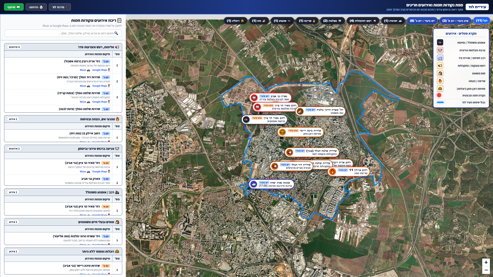
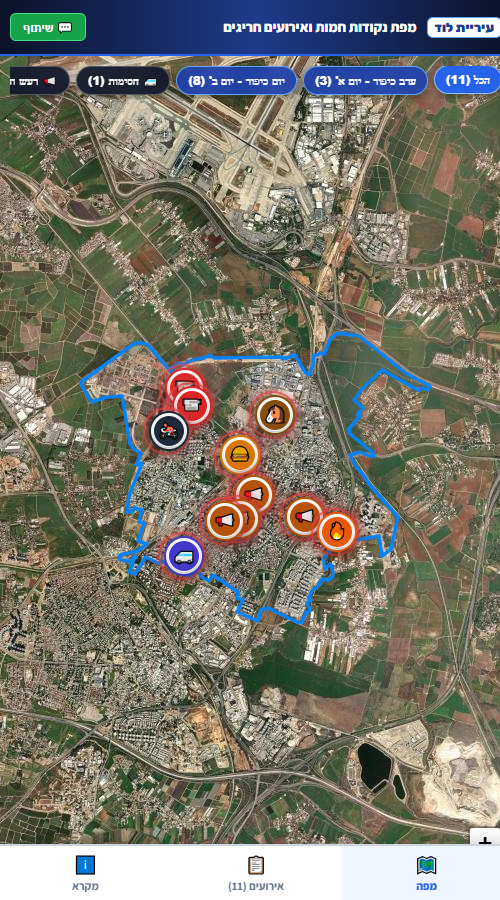

# מפת נקודות חמות ואירועים חריגים - עיריית לוד 📍 | מבצע יום הכיפורים

דשבורד מבצעי אינטראקטיבי וריספונסיבי (מותאם באופן מלא למחשבים נייחים, טאבלטים ומכשירי סמארטפון) המציג את מפת הנקודות החמות והאירועים החריגים בעיר לוד במסגרת **מבצע יום הכיפורים** (ערב יום כיפור - יום ראשון, ומהלך ומוצאי יום כיפור - יום שני).



---

## 📱 תצוגת מובייל


---

## 💻 פתיחה ועבודה ב-VS Code
תוכל לפתוח את הפרויקט ב-VS Code באחת משתי דרכים:
1. **בלחיצה כפולה** על הקובץ `open_vscode.bat` שבתיקייה.
2. או פתיחת הטרמינל בתיקייה זו והרצת הפקודה:
   ```bash
   code .
   ```

מומלץ להתקין את התוסף **Live Server** (המוגדר בתוך `.vscode/extensions.json`) ולהפעיל שרת מקומי בלחיצה על `Go Live` בתחתית ה-IDE.

---

## 🚀 העלאה וסנכרון מול GitHub
המאגר כבר מאותחל מקומית ב-Git על ענף `main`.
* **אפשרות מהירה:** הרץ בלחיצה כפולה את הקובץ `push_github.bat` – הוא ייצור עבורך מאגר ב-GitHub ויעלה את כל הקבצים.
* **אפשרות ידנית דרך הטרמינל (GitHub CLI שכבר מחובר בחשבונך):**
  ```bash
  gh repo create lod-hotspots-dashboard --public --source=. --remote=origin --push
  ```

---

## 🌐 פריסה מהירה ל-Vercel (30 שניות)
לאחר שהפרויקט ב-GitHub:
1. היכנס ל-[Vercel.com](https://vercel.com).
2. לחץ על **"Add New..." ➔ "Project"** ובחר את המאגר `lod-hotspots-dashboard`.
3. לחץ על **"Deploy"** – האתר יעלה מיד לאוויר עם כתובת אינטרנט מאובטחת (HTTPS) לשיתוף עם גורמי העירייה והפיקוד.
